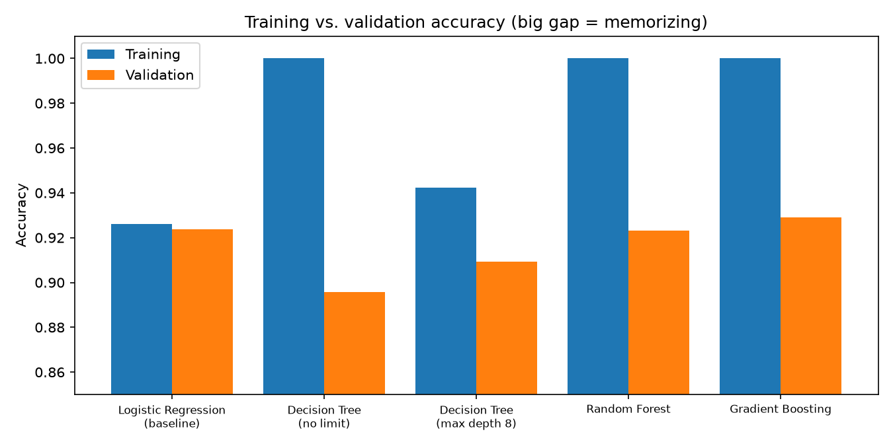
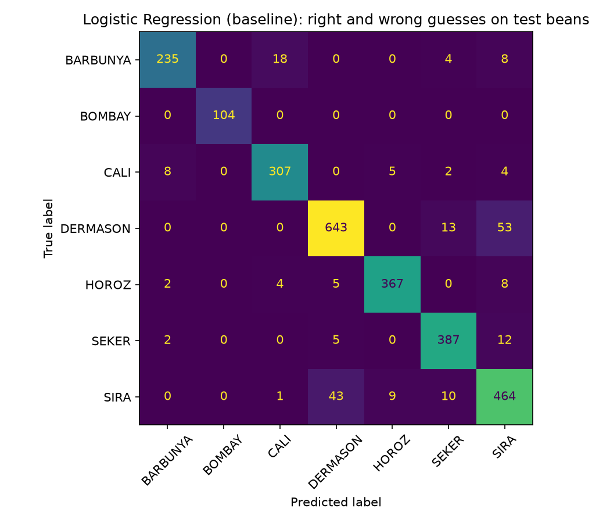
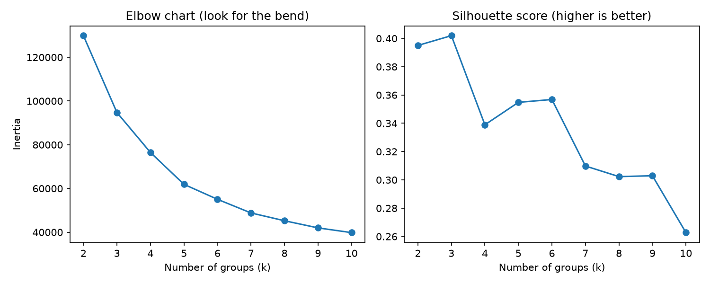
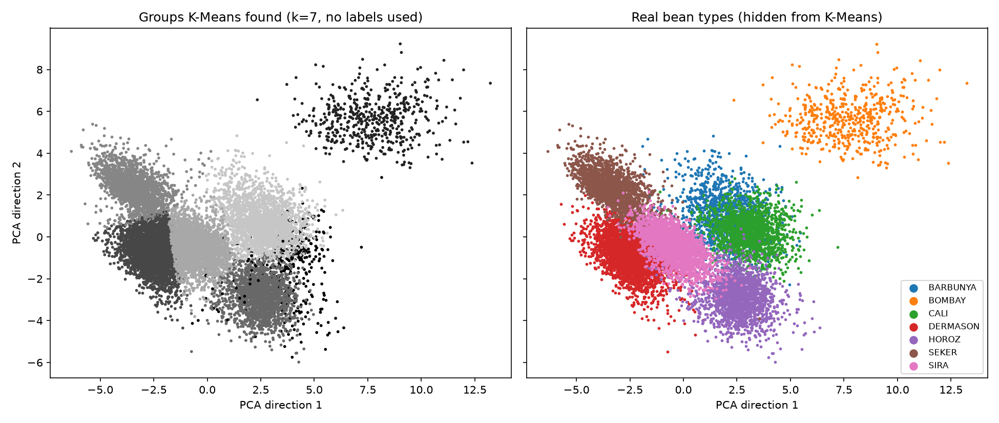

# Which Model Should Sort the Beans?

A bean sorting company takes a picture of every dry bean that goes by on a belt.
From the picture, a computer measures 16 things about the bean's shape, like its
area, its length, and how round it is. The company wants a program that looks at
those 16 numbers and guesses what kind of bean it is.

This project tries four kinds of models, compares them fairly, and picks the one
I would use for a first test version (a "prototype"). The goal is **not** just to
find the highest score. The company also cares about speed, how easy the model is
to keep running, and whether a person can understand why it made a guess.

The project also asks a second question: **if we did not know the bean types,
would the measurements still split the beans into natural groups?**

---

## The data

- **Source:** Koklu, M., and Ozkan, I. A. (2020). Dry Bean [Dataset]. UCI Machine
  Learning Repository. https://doi.org/10.24432/C50S4B
- **License:** CC BY 4.0
- **Size:** 13,611 beans, 16 measurements each, no missing values.
- **What we predict:** `Class`, the bean type. There are 7 types.

The types are not even. There are 3,546 DERMASON beans but only 522 BOMBAY beans.
Because of that, I always split the data in a way that keeps the same mix of
types in every part (this is called a **stratified** split).

| Bean type | How many |
|---|---|
| DERMASON | 3,546 |
| SIRA | 2,636 |
| SEKER | 2,027 |
| HOROZ | 1,928 |
| CALI | 1,630 |
| BARBUNYA | 1,322 |
| BOMBAY | 522 |

---

## How to run it

You need Python 3 (I used Python 3.14). Open a terminal in this folder and run:

```bash
python3 -m venv .venv
```

```bash
source .venv/bin/activate
```

```bash
python -m pip install -r requirements.txt
```

```bash
python compare_models.py
```

```bash
python cluster_beans.py
```

The data downloads by itself the first time (you need internet). Every result,
table, and picture is saved in the `results` folder. The random parts of the code
use a fixed seed number (42), so you should get the same numbers I did. Timing
numbers will be a little different on a different computer.

### Files

| File | What it is |
|---|---|
| `compare_models.py` | Trains and tests the four models and makes the comparison table |
| `cluster_beans.py` | Groups the beans without using the labels |
| `requirements.txt` | The exact library versions I used |
| `results/model_comparison.md` and `.csv` | The main comparison table |
| `results/report_*.txt` | Scores for each bean type, one file per model |
| `results/train_vs_validation.png` | Chart of training score vs. validation score |
| `results/confusion_matrix_*.png` | Which bean types get mixed up |
| `results/feature_importance.png` | Which measurements matter most |
| `results/cluster_*.csv`, `cluster_*.png`, `clusters_*` | Clustering results |
| `results/run_log.txt` | What the model script printed when I ran it |

---

## How I tested the models fairly

1. **Hide a test set.** I put 20% of the beans (2,723) to the side and did not
   touch them until the very end. The other 80% (10,888) are the training beans.
2. **5-fold cross-validation.** I cut the training beans into 5 equal pieces.
   Each model trains on 4 pieces and is checked on the 5th. This happens 5 times
   so every piece gets a turn as the "check" piece. The average is the
   **validation score**. All models got the exact same 5 pieces, so it is fair.
3. **Training score.** I also kept the score each model got on the beans it
   trained on. Comparing the training score with the validation score shows if a
   model is memorizing instead of learning (more on that below).
4. **Final test.** At the end, each model was trained on all the training beans
   and scored once on the hidden test beans.
5. **Two kinds of score.**
   - *Accuracy* = the percent of beans guessed right.
   - *Macro F1* = a score that counts every bean type equally. This matters
     because a model could ignore the rare BOMBAY beans and still have good
     accuracy. Macro F1 would catch that.
6. **Speed and size.** I timed training, timed how long it takes to guess 1,000
   beans, and measured how big the saved model is.
7. **Scaling.** Logistic regression needs all the measurements on the same scale
   (Area is in the tens of thousands, Roundness is less than 1). So I put a
   scaler in front of it inside a pipeline. The scaler only learns from the
   training part of each fold, so no test information leaks in. Tree models do
   not need scaling.

### The models

| Model | Plain-English idea | Settings |
|---|---|---|
| **Logistic Regression** (baseline) | Draws straight-line borders between bean types | Scaled data, max 2,000 steps |
| **Decision Tree** | Asks a chain of yes/no questions like "Is the area bigger than 50,000?" | Tried with no limit, and with a limit of 8 questions deep |
| **Random Forest** | 200 different trees vote on the answer | 200 trees |
| **Gradient Boosting** | Builds trees one after another, each one fixing the last one's mistakes | scikit-learn `HistGradientBoostingClassifier`, default settings |

---

## Results

| Model | Train accuracy | Validation accuracy (5-fold) | Validation spread (+/-) | Gap (train - validation) | Validation F1 (macro) | Test accuracy | Test F1 (macro) | Train time (s) | Predict time per 1,000 beans (ms) | Model size (KB) |
|:--|--:|--:|--:|--:|--:|--:|--:|--:|--:|--:|
| Logistic Regression (baseline) | 0.926 | 0.924 | 0.004 | 0.002 | 0.935 | 0.921 | 0.933 | 0.05 | 0.21 | 3 |
| Decision Tree (no limit) | 1.000 | 0.896 | 0.002 | 0.104 | 0.910 | 0.892 | 0.909 | 0.11 | 0.20 | 165 |
| Decision Tree (max depth 8) | 0.942 | 0.909 | 0.005 | 0.033 | 0.919 | 0.903 | 0.916 | 0.08 | 0.20 | 39 |
| Random Forest | 1.000 | 0.923 | 0.004 | 0.077 | 0.934 | 0.921 | 0.934 | 0.52 | 9.97 | 27,735 |
| Gradient Boosting | 1.000 | 0.929 | 0.006 | 0.071 | 0.941 | 0.922 | 0.934 | 1.03 | 4.25 | 1,022 |

*(Times are from a MacBook. They will change a little each run and on other
computers, but the order from fast to slow stays the same.)*



### What the table tells us

- **The top models are basically tied.** On the hidden test beans, Logistic
  Regression, Random Forest, and Gradient Boosting all land at about 92.1–92.2%.
  Gradient Boosting has the best validation score (0.929), but it is only
  0.005 higher than Logistic Regression. The "spread" column shows the scores
  bounce around by about 0.004–0.006 from fold to fold, so a 0.005 difference is
  about the same size as normal random wobble. It is not a real win.
- **Speed is very different.** To guess 1,000 beans, Logistic Regression takes
  about 0.2 milliseconds. Random Forest takes about 10 milliseconds, which is
  around 50 times slower. Gradient Boosting is about 20 times slower.
- **Size is very different.** The Logistic Regression model is about 3 KB. The
  Random Forest is about 27 MB, almost 10,000 times bigger.
- **Every model is perfect on BOMBAY beans.** BOMBAY beans are much bigger than
  all the others, so they are easy.
- **SIRA is the hardest type.** Every model scores lowest on SIRA (F1 between
  0.81 and 0.86). The confusion matrices show SIRA mostly gets mixed up with DERMASON,
  and BARBUNYA gets mixed up with CALI. These pairs have very similar shapes, so
  the measurements alone may not be enough to tell them apart every time.



---

## Overfitting and underfitting

**Overfitting** means a model memorizes the training beans, like a student who
memorizes the answer key instead of learning the subject. It scores great on
practice and worse on the real test. The sign is a **big gap** between the
training score and the validation score.

**Underfitting** means a model is too simple to learn the pattern. It scores low
on **both** training and validation.

What I saw:

- **Decision Tree (no limit): clear overfitting.** It got 100% on the training
  beans but only 89.6% on validation. That 10-point gap is the biggest of all.
  With no limit, the tree keeps asking questions until every single training bean
  is in its own perfect box, even the odd ones. Those extra questions do not help
  with new beans.
- **Decision Tree (max depth 8): less overfitting.** Limiting the tree to 8
  levels dropped training to 94.2% but *raised* validation to 90.9%. Making the
  model simpler made it better at new beans. That is the clearest proof the first
  tree was overfitting. It is still the weakest model except for the unlimited
  tree, so a single tree seems a little too simple to be the best choice.
- **Random Forest and Gradient Boosting: they memorize too, but it does not hurt
  much.** Both got 100% on training and about 92–93% on validation, a gap of
  about 7–8 points. Even so, their validation scores are among the best. Mixing
  many trees together cancels out a lot of each tree's mistakes. The gap still
  tells us they are much more complicated than this problem needs.
- **Logistic Regression: no overfitting, maybe a little underfitting.** Its
  training (92.6%) and validation (92.4%) scores are almost the same, a gap of
  only 0.2 points. It is not memorizing. Because it only draws straight-line
  borders, it might be a bit too simple to catch every curve in the data. But the
  much more flexible models do not beat it on new beans, so there is not much
  left to catch. The leftover errors look like they come from bean types that
  truly overlap, not from the model being too simple.

---

## My recommendation: Logistic Regression

For the customer's prototype, **I would choose Logistic Regression**, with
Gradient Boosting as the backup to test again later.

| What the customer cares about | Why Logistic Regression wins |
|---|---|
| **Prediction quality** | Tied with the best models on the hidden test beans (92.1% accuracy, 0.933 macro F1). The difference from Gradient Boosting is inside the normal wobble. |
| **Consistency** | The smallest gap between training and validation (0.002). It acts the same on new beans as on old ones, which is what you want when sorting thousands of beans a day. |
| **Speed** | The fastest guesser (about 0.2 ms per 1,000 beans), about 20 times faster than Gradient Boosting and 50 times faster than Random Forest. |
| **Training cost** | Trains in a fraction of a second, so it is cheap to retrain when new beans or a new camera come in. |
| **Maintainability** | A 3 KB file with one scaler and one table of weights. Very little can break, and it is easy to copy onto a small computer next to the belt. |
| **Explainability** | Each bean type has one weight per measurement. You can read the weights and say, for example, "bigger area pushes the guess toward BOMBAY." The tree ensembles have hundreds of trees, which no one can read. |

**Why not the others?**
- *Gradient Boosting* had the best validation score, but only by a hair. It is
  about 20 times slower, about 380 times bigger, and harder to explain. It is
  worth keeping as a backup if real-world testing shows Logistic Regression
  missing a pattern.
- *Random Forest* tied on accuracy but was the slowest and by far the biggest.
- *Decision Tree* is the easiest to explain, but it scored the lowest on new
  beans, even with the depth limit.

### This is not ready to run real sorting machines

This is a classroom model. Before it controls real equipment, it would need more
testing, including:

- Testing on beans from **other farms, harvests, and seasons**, not just this one
  dataset.
- Checking that the **camera and lighting** at the real plant give the same kind
  of measurements.
- Deciding what to do when the model is **not sure** (for example, send unsure
  beans to a person to check), especially for SIRA vs. DERMASON.
- Deciding how costly each kind of mistake is for the business. Mixing up two
  cheap beans may not matter, but mixing up a cheap bean with an expensive one
  might.
- Running it next to the current system for a while and **watching for drift**
  (the scores slowly getting worse as beans or equipment change), then
  retraining when needed.

---

## Clustering: are there natural groups when the labels are hidden?

For this part, the code only used the 16 measurements. The bean types were kept
hidden until the groups were already made.

**Steps:**
1. Scaled the measurements so big numbers (like Area) did not drown out small
   ones (like Roundness).
2. Ran **K-Means**, which puts beans into *k* groups so beans in the same group
   have similar measurements. I tried k = 2 through 10.
3. Scored each k two ways. *Inertia* measures how tight the groups are (lower is
   tighter, but it always goes down when you add groups). *Silhouette* measures
   how clearly each bean belongs to its own group instead of a neighbor
   (higher is better, best is 1).
4. After grouping, I compared the groups with the real types. The group numbers
   are just names (Group 0, Group 1...). They do **not** stand for a bean type.



| k | Silhouette |
|---|---|
| 2 | 0.395 |
| **3** | **0.402 (best)** |
| 4 | 0.339 |
| 5 | 0.355 |
| 6 | 0.357 |
| 7 | 0.310 |
| 8 | 0.302 |

**The math likes 3 groups best, not 7.** The elbow chart has no sharp bend, and
all the silhouette scores are only medium (around 0.3–0.4). That means the beans
do not form neat, separate piles. They mostly form one connected cloud.

### What the 3 groups look like

| Group | Beans | Average area | Roundness | What the hidden labels show |
|---|---|---|---|---|
| 0 | 7,579 | 37,416 | 0.914 | Small, round beans: almost all DERMASON, SEKER, and SIRA |
| 1 | 524 | 173,265 | 0.864 | Very big beans: 522 of the 522 BOMBAY beans |
| 2 | 5,508 | 63,121 | 0.818 | Medium, longer beans: mostly CALI, HOROZ, and BARBUNYA (plus some SIRA) |

So the strongest natural pattern is really about **size and shape**: small and
round, medium and long, and huge. That is a useful finding, but those three
groups are not three bean types.

### Forcing 7 groups

When I asked for 7 groups (the real number of types), the match with the real
types got better (adjusted Rand index 0.67, where 1 would be a perfect match and
0 would be random). Some groups lined up well:

- One group was 520 beans, all BOMBAY.
- One group was mostly SEKER (1,874 of 2,033).
- One group was mostly HOROZ (1,661 of 1,769).
- One group was mostly DERMASON (2,912 of 3,157).

But others did not:

- One group mixed BARBUNYA and CALI almost half and half (1,142 and 1,303).
- One small group of 541 beans was a leftover mix of CALI, HOROZ, and BARBUNYA
  beans that sit near the edges of their types.



*(The map squashes the 16 measurements into 2 directions using PCA so it can be
drawn. Left: groups K-Means found, shaded gray. Right: the real types, shown
only for comparison.)*

### What this means for the customer

- **Useful:** Without any labels, the measurements still clearly separate very
  large beans (BOMBAY) and roughly separate small-round from medium-long beans.
  That could help with a quick size pre-sort or with spotting strange beans that
  do not fit any group.
- **Careful:** A group the math finds is **not automatically a real bean
  type**. The "best" number of groups was 3, not 7. Some groups mixed two types
  together, and one group was just leftovers. The same bean types that confuse
  the supervised models (BARBUNYA/CALI, SIRA/DERMASON) are the same ones the
  clustering could not pull apart. To actually sort by variety, the company
  still needs labeled examples and a supervised model.

---

## Summary

- All four model types work well, between about 89% and 93%.
- The fancy tree ensembles did not beat simple Logistic Regression on new beans
  by any real amount.
- The unlimited decision tree clearly overfit. Limiting its depth helped.
- I recommend **Logistic Regression** for the prototype because it is just as
  accurate, the most consistent, the fastest, the smallest, and the easiest to
  explain. It still needs real-world testing before it runs any machines.
- Clustering finds real size-and-shape groups, but they do not match the 7 bean
  types one-to-one.

## Reference

Koklu, M., and Ozkan, I. A. (2020). Dry Bean [Dataset]. UCI Machine Learning
Repository. https://doi.org/10.24432/C50S4B. Licensed under CC BY 4.0.

Géron, A. (2025). *Hands-On Machine Learning with Scikit-Learn and PyTorch.*
O'Reilly Media.
